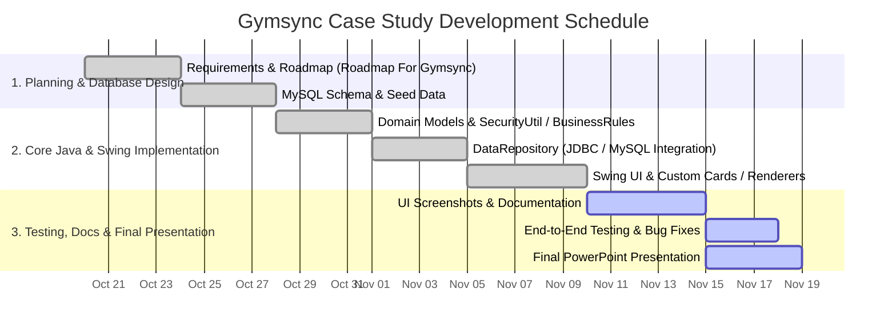

# Gymsync Case Study — Project Gantt Chart

> **Tech Stack:** Java, Java Swing, MySQL  
> **Repository:** `C:\Users\Aaron Musnit\Documents\GitHub\Gymsync`  
> **Last Updated:** 2026-11-15

## Milestone Status

| Phase | Task | Deliverable | Status |
| :--- | :--- | :--- | :--- |
| Planning | Developer Roadmap | `Roadmap For Gymsync` | Done |
| Database | MySQL Schema & Seed | `gymsync_database_schema_and_seed.sql` | Done |
| Backend | Models, Security, Business Rules, DataRepository | `gymsyncapp.java` | Done |
| Frontend | Java Swing UI & Custom Components | `gymsyncapp.java` | Done |
| Documentation | UI Screenshots & Gantt Chart | `Documentation/` | In Progress |
| Presentation | Final Case Study PowerPoint | `Documentation/Gymsync_Final_Presentation.pptx` | In Progress |
